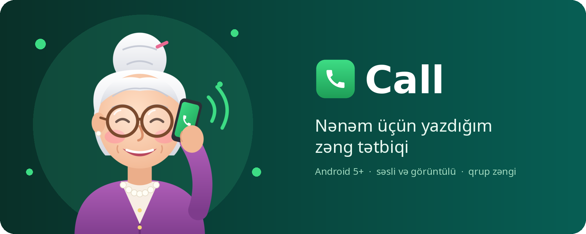
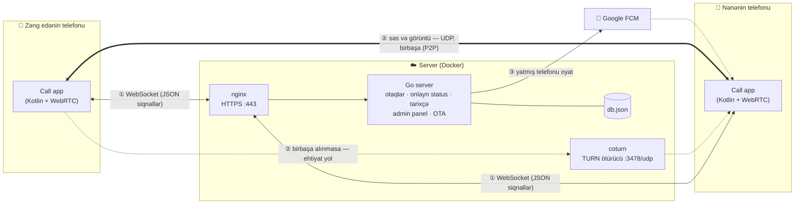
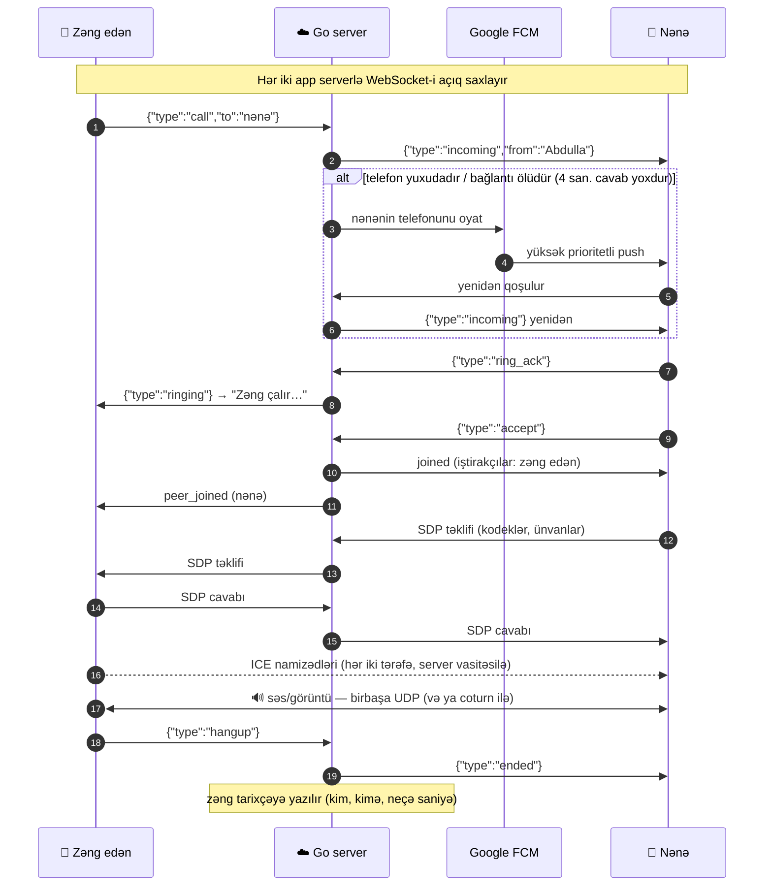

<p align="center">
  
</p>

# Call

> Nənəm üçün yazdığım, öz serverində işləyən sadə zəng tətbiqi.

[English](README.md) · **Azərbaycanca**

## Hekayə

Salam hər kəsə! Bu gün maraqlı bir problem haqqında yazmaq istədim.

Nənəmin telefonu **Samsung Galaxy A3 (2015)**-dür, versiyası **Android 5.0.2**. WhatsApp artıq bu telefonu
dəstəkləmir, digər tətbiqlər isə ya yüklənmir, ya da açılmır, çünki telefon onları "götürmür". Nənəmə isə
çox şey lazım deyil: sadəcə zəng gəlsin, zəng getsin. Ən çox zəng edənlər də nənəm, xalam, dayım və mənəm.

Ona görə məhz bunun üçün bir tətbiq yazdım: **zəng gedir, zəng gəlir**. Artıq düymə, menyu, reklam yoxdur.
Ailə üzvlərinin siyahısı, böyük düymələr, tam ekran zəng pəncərəsi, vəssalam.

Reponu paylaşıram, bəlkə kiminsə də köhnə telefonlu nənəsi, babası var. ❤️

## Nə edir

- **Səsli və görüntülü zəng.** Səs və görüntü telefonlar arasında birbaşa gedir (WebRTC, Opus, exo ləğvi).
- **Qrup zəngi, 4 nəfərə qədər.** Danışıq vaxtı adam əlavə etmək olur, WhatsApp kimi.
- **WhatsApp tipli zəng ekranı:**
  - Kameranı açanda öz görüntün bütün ekranda olur.
  - Qarşı tərəfin görüntüsü gələndə sən kiçik pəncərəyə keçirsən. Pəncərəni sürüşdürmək olur, toxunanda yerlər dəyişir.
  - Android 8+ telefonlarda zəng üzən pəncərəyə keçə bilir.
- **Telefon yuxuda olsa da zəng çalır:**
  - Hər 45 saniyədə bağlantı yoxlanılır.
  - Zəng telefona çatmasa, Google push (FCM) onu oyadır.
  - Telefon zəngi aldığını təsdiqləyir, ölü bağlantı bir neçə saniyəyə yenilənir.
- **Zəng tarixçəsi:** müddət, buraxılmış və rədd edilmiş zənglər. Qrup zəngi tək sətir kimi görünür. Buraxılmış zəng üçün bildiriş gəlir.
- **Qruplar:** hər qrupun öz qoşulma kodu var. Hər kəs yalnız öz qrupunu görür və yalnız ona zəng edə bilir.
- **Admin panel (gizli ünvanda):**
  - cihazlar, app versiyaları;
  - ban, ad dəyişmə, qrupa köçürmə;
  - zəng jurnalı və hər adamın danışıq vaxtı;
  - qoşulma kodları, yeniləmələr, zəng səsi.
- **Serverdən yeniləmə (OTA):** yeni versiyanı admin paneldən göndərirsən. Telefonlar SHA-256-nı və imza açarını yoxlayıb quraşdırır.
- **Dil:** standart olaraq azərbaycanca, ingilis dili də var.
- **Android 5.0+ (minSdk 21).** Galaxy A3 (5.0.2), Galaxy A04 və Honor (Android 14) üzərində sınanıb.

## Necə işləyir

### Arxitektura



**İki ayrı yol** var:

| | Nə gedir | Yol | Go serverdən keçirmi? |
|---|---|---|---|
| ① **Siqnallar** | kiçik JSON mesajlar: *zəng*, *çalır*, *cavab*, *bitir*, şəbəkə ünvanları (SDP/ICE) | telefon → nginx → Go server → o biri telefon, daim açıq WebSocket ilə | **Bəli, həmişə** |
| ② **Səs və görüntü** | Opus/VP8 paketləri, saniyədə ~50 UDP paketi | telefonlar arasında birbaşa (WebRTC) | **Xeyr** |
| ② **Səs, ehtiyat yol** | eyni paketlər, NAT birbaşa bağlantıya mane olanda | telefon → coturn → telefon | Xeyr, coturn şifrəli paketləri sadəcə ötürür |
| ③ **Oyatma** | "bu telefonu oyat" | Go server → Google FCM → telefon | yalnız push |

### Bir zəng, addım-addım



Server **telefon stansiyası** kimidir: kimin onlayn olduğunu bilir və xətti birləşdirir.
Danışığın özü isə **telefonlar arasında** gedir.

### Hissələr

- **server/**: tək Go binary (`main.go`, `calls.go`, `push.go`, `update.go`), admin panel içinə yerləşdirilib.
  Server yalnız siqnalları ötürür. Səs və görüntü telefonlar arasında birbaşa gedir, NAT mane olanda TURN üzərindən.
- **android/**: native Kotlin tətbiqi, WebView yoxdur. `stream-webrtc-android` (zəng), OkHttp WebSocket (serverlə bağlantı),
  bağlantını daim saxlayan foreground service və oyatma üçün `firebase-messaging`.
- **deploy/**: Docker Compose (server + coturn), nginx konfiqurasiyası. TLS certbot ilə.

### Android 5-də işləməsi üçün edilənlər

- **TLS:** Android 5 Let's Encrypt-in indiki kök sertifikatlarını tanımır. Tətbiq ISRG köklərini özü ilə gətirir və yalnız onlara etibar edir. Bu, eyni zamanda sertifikat pinning rolunu oynayır.
- **Firebase:** `firebase-messaging` 24.1.x minSdk 21-i dəstəkləyən son versiyadır.
- **Yeniləmə:** Android 5-də klassik quraşdırıcı, yeni telefonlarda `PackageInstaller` sessiyası işlədilir.
- **Zəng səsi:** yalnız MP3 və AAC qəbul olunur, Android 5 Opus çala bilmir. Səs çalmasa, əvvəl telefonun öz zəng səsinə, sonra sadə siqnala keçir. Telefon heç vaxt səssiz çalmır.
- **Yuxu:** köhnə Android boş bağlantını tətbiqə xəbər vermədən öldürür. Ona görə dəqiq alarm telefonu 45 saniyədən bir oyadır.

## Özün qur

Lazım olanlar: kiçik server (1 vCPU, 1 GB RAM), domen və öz serverinin ünvanı ilə yığılmış APK.
**Addım-addım bələdçi: [docs/SELF_HOSTING.md](docs/SELF_HOSTING.md)** (ingiliscə).

Qısaca:

```bash
# server
cd deploy && ./setup.sh call.senin-domenin.com   # .env və nginx yaradır, admin linkini və qrup kodunu göstərir
docker compose up -d --build                     # Go serveri mənbə koddan yığır

# app (android/local.properties: call.server=https://call.senin-domenin.com)
cd android && ./gradlew assembleRelease
```

## Töhfə vermək

Töhfələrə açığıq: xəta bildirişi, təklif və pull request.

1. Əvvəlcə **issue aç**: nəyi dəyişmək istədiyini, xətanın necə təkrarlandığını (telefon modeli, Android versiyası) yaz.
2. Reponu fork et, ayrıca branch-da işlə: `git checkout -b fix/qisa-ad`.
3. Kod yazarkən bunları nəzərə al:
   - **Sadəlik birinci gəlir.** Bu tətbiqi yaşlı insanlar işlədir. Hər yeni düymə və ya menyu bir sual doğurur. Lazım deyilsə, əlavə etmə.
   - **Android 5 ilə uyğunluq.** minSdk 21 qalır. API 21-dən yeni funksiyaları yalnız `Build.VERSION.SDK_INT` yoxlaması ilə işlət.
   - **Mətnlər** `res/values/strings.xml` (azərbaycanca) və `res/values-en/strings.xml` (ingiliscə) fayllarında olsun, kodda sabit mətn olmasın.
   - **Server:** qlobal vəziyyət `mu` ilə qorunur. "caller holds mu" şərhlərinə əməl et, `go vet` və `gofmt` təmiz olsun.
   - **Gizli məlumatları heç vaxt commit etmə:** imza açarı, `keystore.properties`, `google-services.json`, `.env`, `fcm.json`. Hamısı `.gitignore`-dadır.
4. Dəyişikliyi yoxla:
   - `cd server && go vet && go build`
   - `cd android && ./gradlew assembleRelease`
   - mümkünsə iki telefon (və ya emulyator + telefon) arasında real zəng.
5. Pull request aç: nə dəyişdiyini, niyə dəyişdiyini və necə yoxladığını qısa yaz. Ekran dəyişibsə, şəkil əlavə et.

Commit mesajları qısa və aydın olsun, məsələn: `fix: zəng bitəndə zəng səsi dayanmırdı`.

## Təhlükəsizlik

- Admin panel və onun API-si yalnız təsadüfi gizli ünvanda işləyir, qalan bütün ünvanlar 404 qaytarır.
- Qoşulma kodlarına təxmin limiti qoyulub. Ban cihaz ID-si ilə işləyir.
- Cihaz token-ləri serverdən çıxmır. Yeniləmə APK-sını yükləmək üçün cihaz token-i tələb olunur.
- Gizli fayllar (`.env`, `fcm.json`, imza açarı, `google-services.json`) `.gitignore`-dadır.

Təhlükəsizlik boşluğu tapsan, açıq issue yerinə birbaşa mənə yaz.

## Təşəkkür

Nənə illüstrasiyası: bu layihə üçün çəkilmiş orijinal rəsm (`design/grandma.svg`).

Nənəm üçün sevgi ilə yazılıb. ❤️
