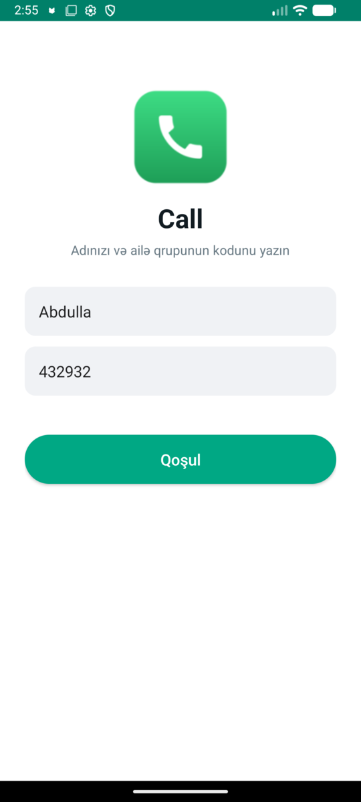
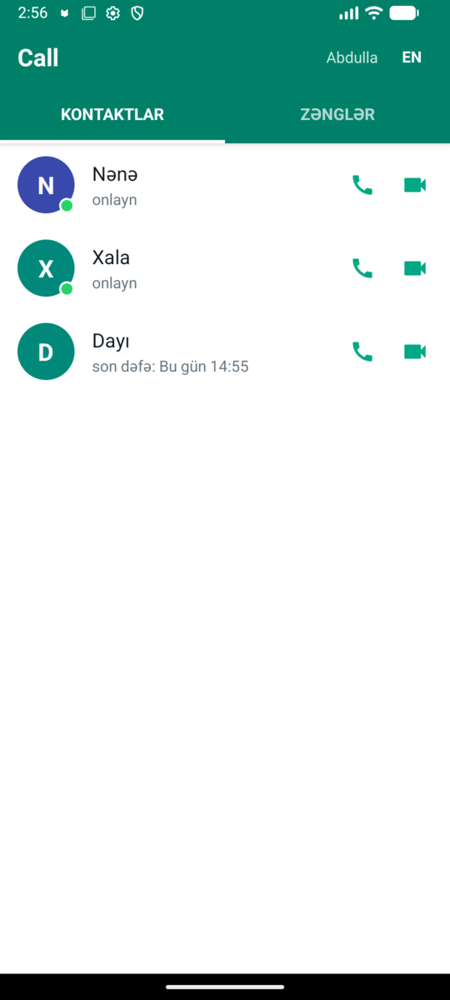
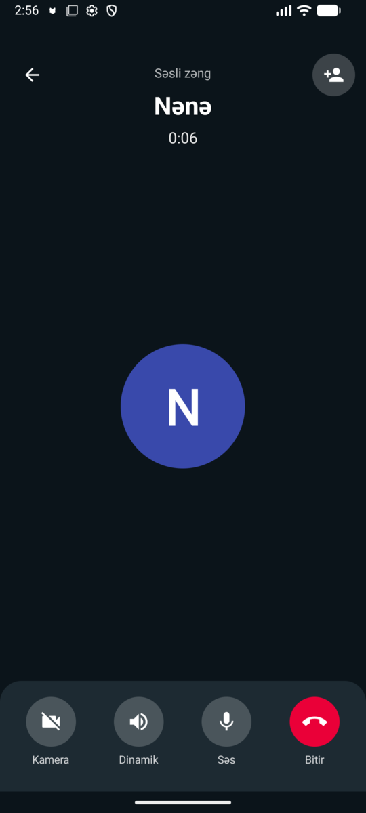
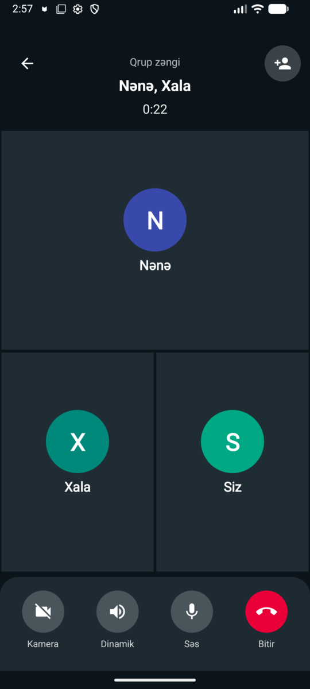
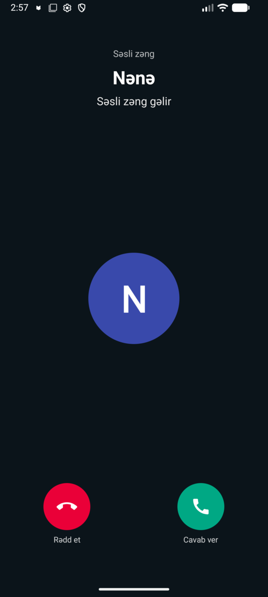
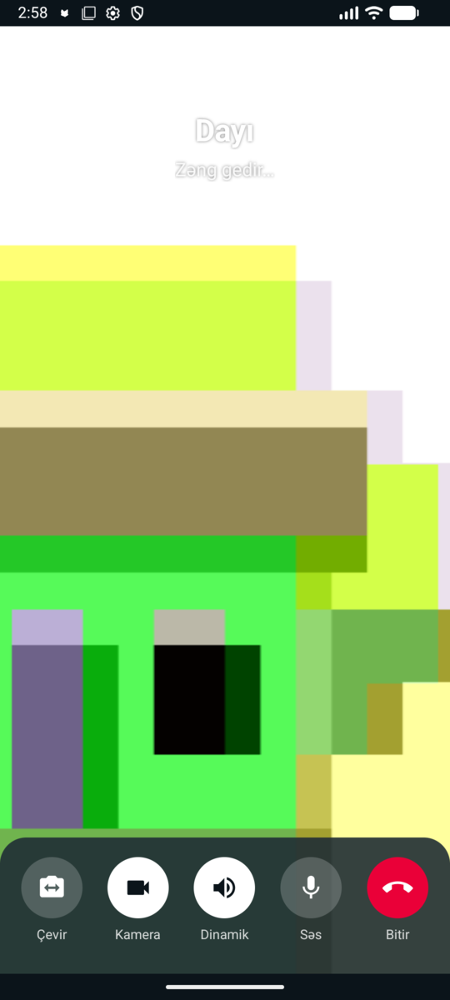
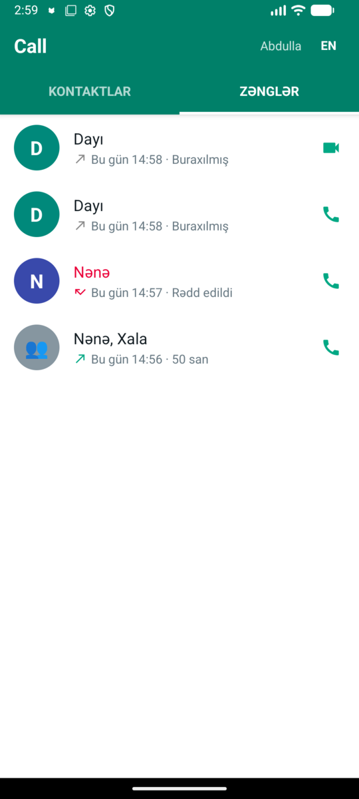
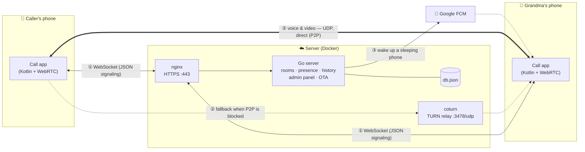
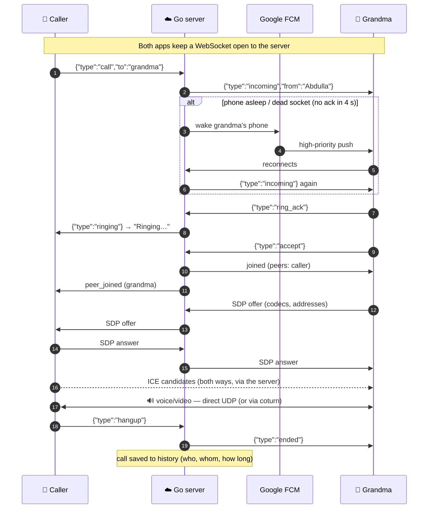

<p align="center">
  
</p>

# Call

> A small, self-hosted calling app I built for my grandma.

**English** · [Azərbaycanca](README.az.md)

## The story

Hi everyone, I want to share an interesting problem I ran into.

My grandma's phone is a **Samsung Galaxy A3 (2015)** running **Android 5.0.2**. WhatsApp no longer
supports it, and the other calling apps either refuse to install or simply won't open on such an
old Android version. All she really needs is to call and be called by the family: me, my aunt and
my uncle.

So I wrote an app that does exactly that: **calls go out, calls come in**. Nothing else to get lost
in. Big buttons, one list of family members, a full-screen ringing screen, and that's it.

I'm sharing the repo in case someone else has a grandparent with an old phone.

## Screenshots

<table>
<tr><td align="center"><br><sub>Join with name + group code</sub></td><td align="center"><br><sub>Family contacts</sub></td><td align="center"><br><sub>Voice call</sub></td><td align="center"><br><sub>Group call (up to 4)</sub></td></tr>
<tr><td align="center"><br><sub>Incoming call</sub></td><td align="center"><br><sub>Video call: your camera</sub></td><td align="center"><br><sub>Call history</sub></td></tr>
</table>

<sub>The app is in Azerbaijani by default; English is one tap away (EN button).</sub>

## What it does

- **Voice and video calls** between family members, peer-to-peer over WebRTC (Opus audio, echo cancellation).
- **Group calls** of up to 4 people: add someone in the middle of a call, like WhatsApp.
- **WhatsApp-style call screen**: your own camera full screen until the other side's video arrives, then a draggable
  picture-in-picture you can tap to swap; floating window on Android 8+.
- **Rings even when the app is asleep**: a keep-alive heartbeat plus a Google push (FCM) wake-up when the phone
  can't be reached, and a delivery acknowledgement so a dead connection is replaced within seconds.
- **Call history** with durations, missed and declined calls, group calls shown as one entry, missed-call notifications.
- **Groups**: each group has its own join code; members only see and call each other.
- **Admin panel** (hidden URL): devices, app versions, ban/rename/move, call log and talk time per person,
  join codes, OTA updates, custom ringtone.
- **Over-the-air updates** from the admin panel, verified by SHA-256 and the app's signing key.
- **Azerbaijani by default**, English optional.
- Works on **Android 5.0+** (minSdk 21); tested on a Galaxy A3 (5.0.2), a Galaxy A04 and an Honor phone (Android 14).

## How it works

### Architecture



There are **two separate paths**:

| | What travels | Path | Through the Go server? |
|---|---|---|---|
| ① **Signaling** | small JSON messages: *call*, *ringing*, *answer*, *hang up*, network addresses (SDP/ICE) | phone → nginx → Go server → other phone, over a WebSocket that stays open | **Yes, always** |
| ② **Media** | voice & video (Opus/VP8), ~50 UDP packets per second | straight between the phones (WebRTC) | **No** |
| ② **Media, fallback** | same packets, when NAT blocks a direct connection | phone → coturn → phone | No; coturn only relays encrypted packets |
| ③ **Wake-up** | "wake this phone" | Go server → Google FCM → phone | push only |

### One call, step by step



The server is the **switchboard**: it knows who is online and connects the line.
The conversation itself happens **between the phones**.

### Components

- **server/** — a single Go binary (`main.go`, `calls.go`, `push.go`, `update.go`) with the admin panel embedded.
  It relays signaling only; audio and video go directly between phones, or through TURN when NAT gets in the way.
- **android/** — a native Kotlin app (no WebView): `stream-webrtc-android`, OkHttp WebSocket, a foreground service
  that keeps the connection alive, and `firebase-messaging` for wake-ups.
- **deploy/** — Docker Compose (server + coturn) and an nginx site; TLS via certbot.

### Making it work on Android 5

Old phones needed a few extra tricks:

- **TLS**: Android 5 doesn't trust Let's Encrypt's current roots, so the app bundles the ISRG roots and trusts only
  them (which doubles as certificate pinning).
- **Firebase**: `firebase-messaging` 24.1.x is the last line that still supports minSdk 21.
- **Updates**: Android 5 uses the classic package installer; newer phones use `PackageInstaller` sessions.
- **Ringtones**: only MP3/AAC are accepted, because Android 5 can't play Opus; if a tone fails, the phone falls back
  to its own ringtone, then a plain beep, so it never rings silently.
- **Sleep**: an exact alarm wakes the phone every 45 s for a heartbeat, because old Android versions kill idle sockets
  without telling the app.

## Run it yourself

All you need is a small server (1 vCPU, 1 GB RAM), a domain, and an APK built with your server's address.
**Follow the step-by-step guide: [docs/SELF_HOSTING.md](docs/SELF_HOSTING.md).**

The short version:

```bash
# server
cd deploy && ./setup.sh call.yourname.com    # writes .env + nginx config, prints admin link & join code
docker compose up -d --build                 # builds the Go server from source

# app (android/local.properties: call.server=https://call.yourname.com)
cd android && ./gradlew assembleRelease
```

## Contributing

Contributions are welcome: bug reports, ideas and pull requests.

1. **Open an issue first.** Describe what you want to change, or how to reproduce the bug
   (phone model and Android version help a lot).
2. **Fork and branch:** `git checkout -b fix/short-name`.
3. **While coding, keep in mind:**
   - **Simplicity comes first.** The people using this app are grandparents. Every extra button or menu is a
     question they have to ask someone. If it isn't needed, leave it out.
   - **Android 5 must keep working.** minSdk stays 21. Anything newer than API 21 goes behind a
     `Build.VERSION.SDK_INT` check.
   - **No hardcoded text.** Strings live in `res/values/strings.xml` (Azerbaijani) and `res/values-en/strings.xml` (English).
   - **Server:** global state is guarded by `mu`. Respect the "caller holds mu" comments, and keep `go vet` and `gofmt` clean.
   - **Never commit secrets:** the signing key, `keystore.properties`, `google-services.json`, `.env`, `fcm.json`.
     They are all in `.gitignore`.
4. **Test your change:**
   - `cd server && go vet && go build`
   - `cd android && ./gradlew assembleRelease`
   - if you can, a real call between two phones (or an emulator and a phone).
5. **Open a pull request:** what changed, why, and how you tested it. Add a screenshot if the UI changed.

Keep commit messages short and clear, for example: `fix: ringtone kept playing after the call ended`.

## Security notes

- The admin panel and its API only exist under a random secret path; everything else returns 404.
- Join codes are rate-limited; banning works per device ID.
- Device tokens never leave the server; the APK download for updates requires a device token.
- Secrets (`.env`, `fcm.json`, signing key, `google-services.json`) are git-ignored.

Found a security issue? Please contact me directly instead of opening a public issue.

## Credits

Grandma illustration: original artwork made for this project (`design/grandma.svg`).
Built with love for my grandma. ❤️
